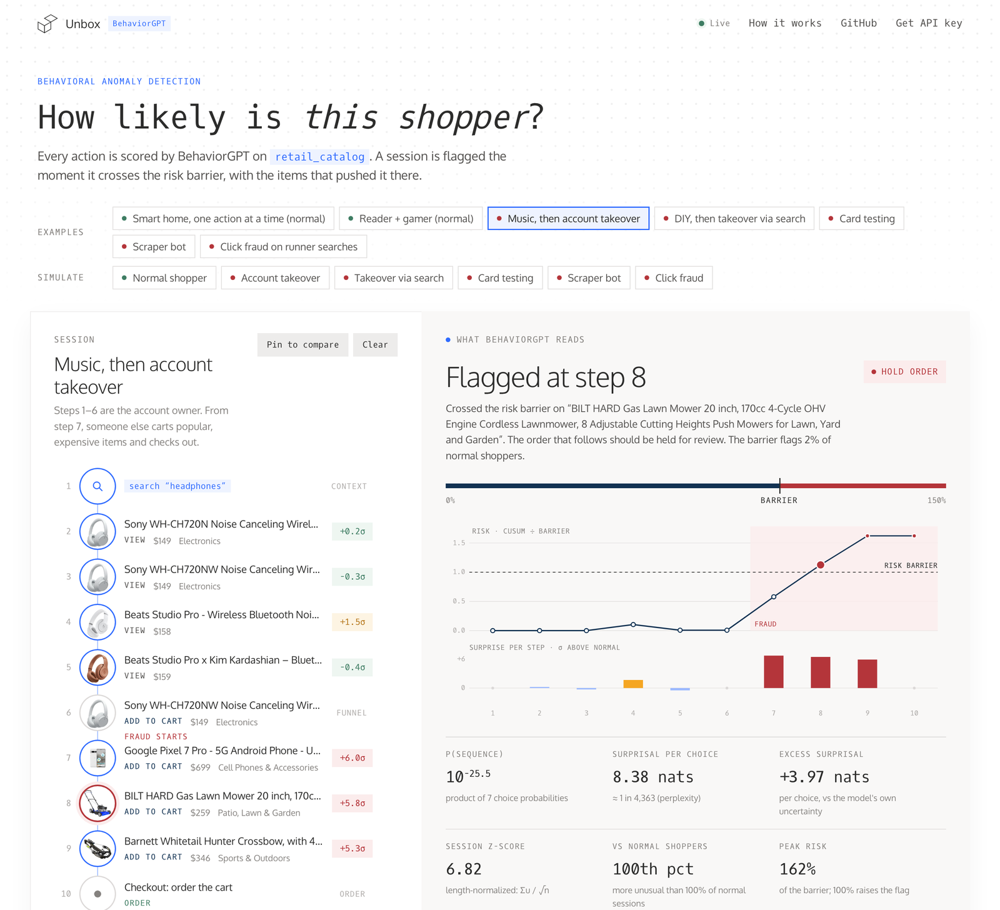
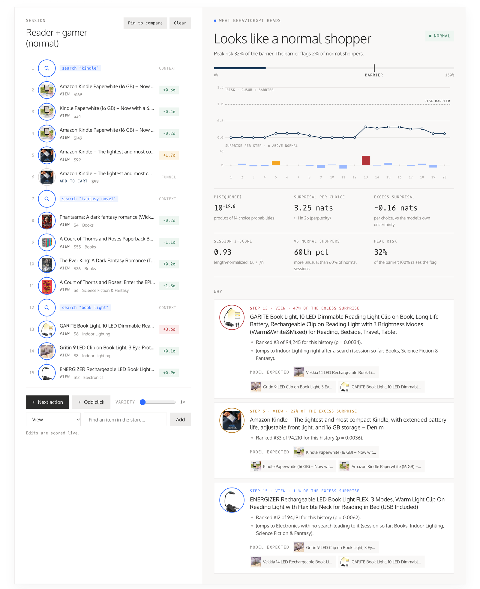
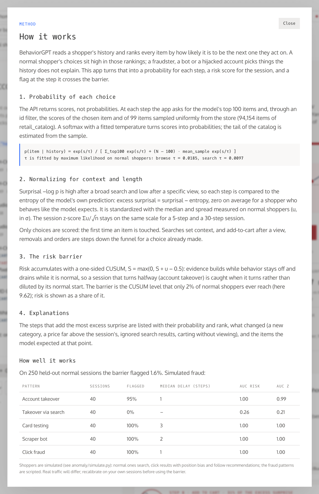
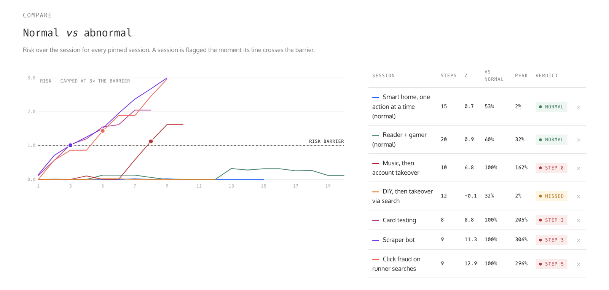

# Behavioral anomaly detection with BehaviorGPT

[](https://github.com/Unbox-AI/behaviorgpt-anomaly/actions/workflows/ci.yml)
[](LICENSE)

**How likely is this shopper's sequence of actions?** This app scores every step of a shopping session with [BehaviorGPT](https://unboxai.com/behaviorgpt), Unbox AI's foundation model for behavior, on its public `retail_catalog`. It flags the step where a session crosses a calibrated risk barrier and names the items that pushed it there. No fraud labels, no rules and no training: the model has only read the history.



You can:

- load examples of normal shoppers and five fraud patterns, or simulate new ones;
- build a session yourself, one event or one simulated **next action** at a time, and watch the risk update live;
- see why a session was flagged: each surprising step, its probability and rank, and what the model expected instead;
- pin sessions and compare normal and abnormal risk curves side by side.

<p align="center">
  
  
</p>



## Why a behavior model can catch fraud

BehaviorGPT reads a shopper's history and ranks every item by how likely it is to be the next one they act on. A normal shopper's choices sit high in those rankings: after searching "headphones" and viewing two Sony models, a pair of Beats is unsurprising. A fraudster, a bot or a hijacked account does things the history does not explain: a Pixel phone, a lawn mower and a crossbow carted straight after headphones; a stream of cheap unrelated items; random product pages. The detector turns that into a probability for each step and a risk score for the session.

## Quick start

Needs [uv](https://github.com/astral-sh/uv) and Python 3.11+.

```sh
git clone https://github.com/Unbox-AI/behaviorgpt-anomaly.git
cd behaviorgpt-anomaly
uv sync
cp .env.example .env     # paste your UNBOXAI_API_KEY (optional)
uv run uvicorn anomaly.server:app --port 8000
```

Open <http://localhost:8000>. Without a key the bundled examples still work (their model outputs ship in `data/examples.json`); with a key you can simulate new shoppers, edit sequences and add events. Get a key at [unboxai.com/behaviorgpt](https://unboxai.com/behaviorgpt).

## How it works

### 1. The probability of each choice

The API returns ranking scores, not probabilities. At each step the detector makes two calls for the history so far:

- the model's top 100 items, with their scores (the head);
- through an `id` filter, the scores of the item the shopper actually chose and of 99 items sampled uniformly from the store (the tail).

A softmax with temperature τ turns scores into probabilities. The partition function is the exact sum over the head plus the tail sum, estimated from the sample:

```
p(item | history) = exp(s/τ) / [ Σ_top100 exp(s/τ) + (N − 100) · mean_sample exp(s/τ) ]
```

τ is fitted by maximum likelihood on normal shoppers, separately after a search and while browsing. A small uniform mixture (ε = 2%) bounds the surprisal of any one step.

The API cannot list `retail_catalog`, and it is larger than the ~94 000 items any set of rankings reaches. The store is therefore the snapshot in `data/catalog.json.gz`, plus whatever the model ranks in its top 100. Probabilities are relative to this fixed set, so every step and every session is measured against the same store.

### 2. Normalizing for context and length

- **Context.** Surprisal, −log p, is naturally high after a broad search and low after viewing one specific item. Each step is compared with the entropy of the model's own prediction: *excess surprisal* = surprisal − entropy. It averages zero for a shopper who behaves like the model expects, in any context. It is then standardized with the median and spread measured on normal shoppers (u, in σ), and clipped to [−3, 6] so no single click dominates.
- **Length.** The session z-score Σu / √n stays on the same scale for a 5-step and a 30-step session.
- **What counts as a choice.** Only the first time an item is touched is scored. Searches set context. Adding to cart after a view, removals and orders are steps down the funnel for a choice already made; the model ranks items already seen low on purpose, so scoring them would make normal checkouts look suspicious.
- **Where a click came from.** After a search, shoppers either follow a recommendation from the item they are on or go back to the results. Each choice after a search is read in both contexts (the history, and the history plus the last query again) and scored in the one that explains it better. Calibration does the same, so this does not make sessions look more normal than normal shoppers do.

### 3. The risk barrier

Risk accumulates with a one-sided CUSUM:

```
S_t = max(0, S_{t−1} + u_t − k),   k = 0.5
```

Evidence builds while the behavior stays off and drains while it is normal. A session that turns halfway, such as an account takeover, is caught at the step it turns rather than diluted by its normal start. The barrier is the CUSUM level that only 2% of normal shoppers ever reach. Risk is shown as a share of the barrier; 100% raises the flag, and an order placed after it should be held for review.

### 4. Explanations

The steps that add the most excess surprise are listed with:

- their probability and rank in the store;
- what changed: a jump to a new category with no search leading to it, a price far above the session's median, a click outside the top results of the last search, carting without viewing;
- the items the model expected at that point.

## How well it works

`scripts/calibrate.py` simulates shoppers and fits everything above on half of the normal sessions. It measures on the other half and on the fraud sessions:

| Pattern | Sessions | Flagged | Median delay | AUC |
| --- | ---: | ---: | ---: | ---: |
| Account takeover | 40 | 95% | 1 step | 1.00 |
| Card testing | 40 | 100% | 3 steps | 1.00 |
| Scraper | 40 | 100% | 2 steps | 1.00 |
| Click fraud | 40 | 100% | 1 step | 1.00 |
| Takeover via search | 40 | 0% | – | 0.26 |

The barrier flagged 1.6% of 250 held-out normal sessions; the target was 2%. The account takeovers it misses are the short ones (three carted items): their peak risk is still above almost every normal session's, but below the barrier. *Delay* counts events after the first fraudulent one, searches included, before the flag. *AUC* is the probability that a fraud session's peak risk is higher than a normal one's.

**The blind spot is kept on purpose.** In a takeover via search, the attacker searches for expensive goods ("macbook pro", "nintendo switch") and carts a top result each time. That is what a normal shopper does, so every step is unsurprising, and these sessions score *lower* than normal ones. Scoring the intent of each search (the first choice after it, read on the history before the query) does not separate them: by probability, rank or raw score, normal shoppers' intent changes and the attacker's look the same. Within one session, the model cannot tell an attacker from an owner who decided to buy a laptop. Catch this pattern with signals outside the session's clicks, such as a new device, a new shipping address, or the owner's earlier sessions.

Normal shoppers have one or two intents. They search, click results with the usual position bias, sometimes follow a recommendation and go back to the results, sometimes click a trending item, cart what they viewed and sometimes check out. A third of them, after their first search, carry on one action at a time the way the app's **+ Next action** button does: mostly views of an item sampled from the model's own distribution, sometimes carting the item just viewed, checking out, or searching for something new. The model learned that distribution from real behavior, so following it is normal by definition. Without these sessions, normal is defined as "always clicks a top result", and the barrier slowly flags anyone who browses more widely. The fraud patterns are scripted:

- **Account takeover:** the owner's normal session, then popular, expensive items from categories the owner never looked at, carted and ordered.
- **Takeover via search:** the same, but each item is found by searching for it and carting a top result.
- **Card testing:** cheap, unrelated items carted straight away and ordered.
- **Scraper:** random product pages, one after another.
- **Click fraud:** searches followed by clicks on unrelated items.

These are simulations, and they are separable on purpose, to show the mechanics. Real traffic is messier, and real fraud adapts. Before using the barrier on real sessions, recalibrate on them: replace the simulator with your logged sessions, and set the barrier from the false-alarm rate you can afford.

## Project layout

```
anomaly/
  scoring.py      probability, entropy and rank of a choice from head and tail scores
  detector.py     which events are scored, contexts, CUSUM, explanations
  calibration.py  the fitted numbers (data/calibration.json)
  simulate.py     normal personas and fraud patterns
  api.py          BehaviorGPT calls with retries, a thread pool and a SQLite cache
  catalog.py      the store snapshot and its search index
  events.py       events as JSON records and as SDK objects
  server.py       FastAPI: /api/score, /api/simulate, /api/next, /api/items
  suggest.py      sampling a plausible next item: temperature, top-p, near-duplicate filter
web/              the front end: plain HTML, CSS and JavaScript, no build step
docs/             screenshots
scripts/
  snapshot_catalog.py  rebuild data/catalog.json.gz
  calibrate.py         simulate, fit, evaluate; writes calibration.json and examples.json
tests/
```

## Development

```sh
uv run pytest           # tests use a fake API: no key or network needed
uv run ruff check . && uv run ruff format --check .
```

## Rebuilding the data

Both scripts cache every API response in `data/cache.sqlite`, so reruns are fast.

```sh
uv run python scripts/snapshot_catalog.py   # the store, ~10 rankings × 100 pages
uv run python scripts/calibrate.py          # 500 normal + 5 × 40 fraud sessions
```

To use another catalog, embed it with the [SDK](https://github.com/Unbox-AI/behaviorgpt#your-own-catalog), pass `--catalog <id>` to the snapshot script, adjust the personas in `anomaly/simulate.py` to your items, and recalibrate.

## API

| Endpoint | What it does |
| --- | --- |
| `POST /api/score` | `{events: [...]}` → per-step probabilities, risk, flag and explanations |
| `POST /api/simulate` | `{kind, seed?, persona?}` → a simulated session |
| `POST /api/next` | `{events, odd, temperature?}` → the shopper's next action (a view of an item sampled from the model, carting what was just viewed, an order or a new search), or an odd click |
| `GET /api/items/search?q=` | items in the store, by name |
| `GET /api/meta` | store size, calibration and its evaluation |

An event is `{"type": "search", "query": "..."}`, `{"type": "view" | "add_to_cart" | "remove_from_cart", "item": "<id>"}` or `{"type": "order"}`.

## Deploying

The `Dockerfile` serves the app on `$PORT` (7860 by default, as Hugging Face Spaces expects). Set `UNBOXAI_API_KEY` as a secret to enable live scoring, or leave it unset for an examples-only demo.

## License

MIT
